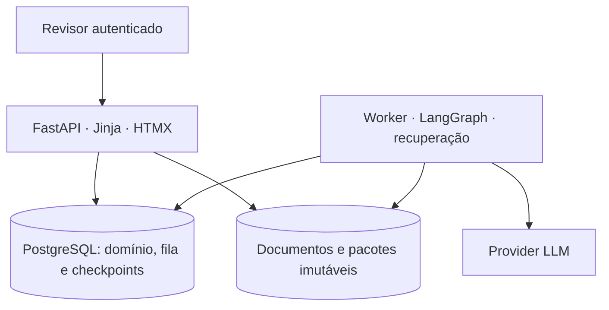

# Design Architecture: Contract Analyzer Enterprise

## 🎯 Objetivo (Problema de Negócio)

Apoiar a revisão de contratos B2B, confrontando um DOCX principal e seus anexos com regras corporativas, fontes controladas e cálculos reproduzíveis. Entregar achados ancorados, sugestões de alteração e decisões humanas rastreáveis, preservando o original e a revisão no Word. Uma organização, inicialmente 3–4 contratos/dia; foco em consistência documental, matemática e cadastral no recorte homologado. A IA interpreta e sugere; Python valida, calcula e executa. A solução não aprova contratos autonomamente nem emite parecer conclusivo.

## 📌 Premissas e Decisões

| Domínio | Arquitetura |
|---|---|
| **Aplicação** | Python, FastAPI/Jinja/HTMX, monólito modular e Ports & Adapters; API/UI e worker em processos separados. Código de pesquisa tem reaproveitamento seletivo. |
| **Orquestração** | LangGraph como biblioteca: `StateGraph`, estado tipado, subgrafos, `Send`, reducers por identidade, `AsyncPostgresSaver`, `interrupt()`/`Command(resume=...)`; sem agente por parágrafo ou ferramentas irrestritas. |
| **Execução durável** | Procrastinate/PostgreSQL atrás de `JobsPort`; heartbeat, recuperação de jobs abandonados, tentativas limitadas e supervisão. Decisão/comando e job compartilham conexão/transação; checkpoint e arquivos exigem reconciliação própria. |
| **Workspace** | Principal editável e DOCX relacionados versionados; anexos participam da análise, mas o Writer altera somente o principal. A execução congela o conjunto documental. |
| **Revisão** | FULL cobre regras aplicáveis; FOCAL declara recorte e expande referências necessárias. `ContextBudgetGate`: contexto direto quando couber; subgrafo hierárquico e passagem global para documentos extensos. |
| **Regras e fontes** | Catálogo versionado, escopo/vigência, aprovação humana e snapshots por run. Seleção por referências e filtros explícitos; histórico auditável, recuperação de precedentes adiada. |
| **Modelo** | Adapter inicial Gemini, substituível; modelo real configurado, saídas estruturadas e validação Pydantic. Mesmo modelo como configuração inicial das etapas locais/globais; escolha por avaliação, sem fallback silencioso. |
| **Reanálise** | Integral após mudança documental; resultados anteriores `STALE`. FOCAL não substitui a revalidação integral de um workspace alterado. |
| **Implantação** | Docker Compose como base reproduzível: aplicação, worker, PostgreSQL e storage persistente. Azure é opção, não requisito da release; domínio independente de plataforma. |

## ⚙️ Escopo da Solução

- **In:** sessão autenticada, upload manual do principal/anexos, metadados, regras/fontes publicadas e reimportação Word.
- **Core:** ingestão segura, mapa OOXML, FULL/FOCAL, contexto direto/hierárquico, cálculos `Decimal`, evidências, propostas, HITL, Writer, retomada e reanálise integral.
- **Out:** portal com andamento, cobertura, blocos, achados, antes/depois, fontes, decisões e histórico; `ReviewPackage(original, redline, clean-internal, findings, evidence, manifest, summary)`, conforme elegibilidade.
- **Evolução — [Epic #109](https://github.com/campos-labs/project-hub/issues/109):** Word/Copilot/MCP, conectores corporativos, precedentes/RAG, composição de cláusulas, lentes adicionais, lotes, reanálise incremental, `clean-external` e governança/operação ampliadas.
- **Fora do recorte:** PDF/OCR, criação integral de contratos, assinatura, CLM completo, negociação autônoma, SaaS multi-tenant, web/SQL livres e aprendizado/publicação autônomos.

## 👥 Usuários e Papéis

- **`reviewer`:** organiza documentos, solicita análises, examina evidências, decide achados e propõe/aprova alterações dentro da alçada; **`approver`:** resolve mudanças materiais, exceções e conflitos.
- **`rule_manager`:** mantém regras/fontes; publicação por pessoa distinta do autor, com versão e auditoria; **`developer_admin`:** configura adapters, operação e avaliações, sem receber automaticamente alçada de negócio.
- **Autorização:** por ação e workspace; identidade autenticada, sessão segura e RBAC. Entra ID/OIDC quando adotado pelo ambiente; identidade sintética restrita a desenvolvimento/testes. Rótulos de autoria do Word não comprovam identidade ou aprovação.

## 🧩 Modelo de Domínio e Dados

### Infraestrutura

- **PostgreSQL:** schemas separados para domínio, fila e checkpoints; mesma base/conexão transacional para decisão e enqueue. Migrações, pools e permissões explícitos; continuidade de manutenção/compatibilidade do Procrastinate verificada antes da adoção produtiva.
- **Storage:** `DocumentStoragePort`, filesystem em volume persistente e objetos identificados por SHA-256; Blob Storage quando implantado no Azure, Azurite para testes do adapter. Hash identifica conteúdo, não concede acesso.
- **Operação:** worker/recuperador supervisionados, capacidade contínua para consumir pendências, concorrência conservadora; limites e timers operacionais próprios. Sem dependência de tráfego HTTP para recuperação.
- **Azure opcional:** Container Apps para API/worker, PostgreSQL gerenciado, Blob, Entra ID, Managed Identity/Key Vault. Validar implantação e recuperação; Redis, Azure AI Search, Agent Server e banco de grafos não integram a base inicial.
- **Estado:** checkpoints guardam IDs, snapshots e referências compactas; binários/XML ficam no storage. `RuntimeContext` injeta adapters/policies; correlação por workspace, revisão, run, thread, comando, job e efeito.

### Entidades e Contratos

| Grupo | Dados essenciais |
|---|---|
| **Workspace/documentos** | `ContractWorkspace`: principal, anexos, responsável, acesso, revisão corrente; `DocumentRevision`: papel, hash, origem, versão anterior, ator/data; arquivos imutáveis. |
| **Estrutura/semântica** | `DocumentMap`/`DocumentUnit`: parte OOXML, unidade local à revisão, hierarquia, projeções, offsets, `char_map`, locator e suporte; `DocumentEvent`: comentário/revisão, autor declarado, intervalo, antes/depois; `ReviewBlock`/`DocumentProfile`: agrupamentos e fatos com referências validadas. |
| **Regras/fontes** | `RuleRelease`: escopo, aplicabilidade, criticidade, critérios, tolerâncias, exceções, fontes obrigatórias, vigência e aprovação; `SourceRevision`/`SourcePolicy`: origem, hash, autoridade, precedência, validade e retirada. |
| **Execução/evidência** | `ReviewRun`: snapshot documental/configuração, modo/escopo, projeção, run anterior, thread, versões, orçamento e cobertura; `Evidence`: fonte/versão, trecho, âncora, validade, acesso e proveniência. |
| **Avaliação/proposta** | `RuleEvaluation`/`Finding`: regra, resultado, razões, cálculos, citações, limitações; `ChangeProposal`: operação, âncora, texto esperado, antes/depois e hash; `DecisionPolicyResult`: rota, motivos, bloqueios e alçada. |
| **Decisão/efeito** | `HumanDecision`: alvo, conteúdo aprovado, identidade, alçada, justificativa e hashes; `ExecutionJob`/`EffectRecord`: tentativas, estado, identidade/hash do efeito e publicação/reconciliação. |
| **Pacote/auditoria** | `ReviewPackage`/`ExecutionManifest`: artefatos, hashes, revisão, cobertura, decisões, configuração e consumo; `AuditEvent`: eventos de negócio rastreáveis. |

### Estados e Atualidade

- **Execução:** `QUEUED → RUNNING → WAITING_HUMAN | READY_FOR_REVIEW | PARTIAL | FAILED_FINAL | CANCELLED`; falha transitória retorna à fila dentro do limite; espera humana libera o worker.
- **Avaliação:** `COMPLIANT | FINDING | NOT_APPLICABLE | INSUFFICIENT_EVIDENCE | UNAVAILABLE | NOT_EVALUATED`; erro não significa conformidade, e exceção humana não apaga o achado.
- **Atualidade:** `CURRENT | STALE | SUPERSEDED`, independente da execução e da aprovação. Mudança no principal/anexos invalida a revisão do conjunto; resultados parciais não revalidam conclusões anteriores.
- **Continuidade:** interrupção retoma a mesma thread; nova revisão documental cria run/thread próprios, vinculados aos anteriores. Regras/fontes preservam snapshots históricos; revogação ou mudança aplicável exige verificar elegibilidade antes de nova decisão/exportação consolidada.

## 🔌 Serviços de Aplicação e Integrações

### Documento e Projeções

`DocxEnginePort` encapsula parser, Writer e reconciliação; `lxml` controla OOXML, `python-docx` auxilia operações suportadas. A matriz de suporte distingue **leitura, alteração, reconciliação e clean**: corpo, tabelas, runs/estilos, comentários e revisões homologados; demais partes preservadas/inventariadas, sem declarar cobertura inexistente.

- **`proposed_view`:** projeção textual com inserções/movimentações de destino incluídas e exclusões/origens omitidas; **`baseline_view`:** projeção anterior às revisões. Aplicáveis aos eventos suportados; estruturas ambíguas são sinalizadas. A visão proposta não representa aceite nem vigência jurídica.
- **Âncoras:** hash da revisão, parte/unidade, projeção, intervalo, texto esperado e mapa exato até o XML; `unit_id` é local à revisão. Linhagem entre versões somente quando reconciliada, nunca presumida por posição ou semelhança.
- **Eventos:** preservar comentários, revisões, autoria declarada e antes/depois separadamente do texto analisado. Conteúdo excluído pode contextualizar a negociação, sem ser misturado silenciosamente à projeção principal.

### Revisão, Contexto e Evidências

1. **Preparar:** validar upload, persistir original, construir `DocumentMap`/perfil estrutural e congelar principal, anexos, regras, fontes e configuração.
2. **Verificar:** aplicar escopo/vigência/aprovação e `SourcePolicy`; fonte obrigatória ausente/revogada bloqueia a avaliação dependente antes do LLM. Conflitos permanecem explícitos ou seguem HITL.
3. **Calcular:** Python/`Decimal`, parcelas completas, moeda, escala, tolerâncias e âncoras; ausência/ambiguidade impede correção por soma parcial. Formato/dígitos cadastrais não comprovam situação oficial; verificações cadastrais dependem de fonte autorizada, identificada e válida.
4. **Contextualizar:** `ContextBudgetGate` antes das chamadas; rota direta ou blocos estruturais com expansão de referências e passagem global. Conclusões globais consultam trechos originais, sem depender apenas de resumos.
5. **Validar:** schema, IDs, enums, âncoras, fontes e citações em cada etapa local e na consolidação; resultados intermediários inválidos não alimentam a etapa global. Reducers consolidam por identidade, evitando duplicações em retries.
6. **Apresentar:** cobertura por regra/escopo, achados, evidências, propostas e pendências; política determinística encaminha criticidade, exceção, conflito e alçada à decisão humana.

FULL considera todas as regras aplicáveis, com insuficiências explícitas; FOCAL informa seleção, expansão e itens não avaliados. Limites de tamanho/contexto e cobertura são homologados; excedentes geram parcialidade ou recusa, nunca truncamento silencioso. Referências explícitas entre unidades, fontes e avaliações bastam; não há `EvidenceGraph` genérico ou índice vetorial obrigatório.

**Provider e orçamento:** modelo real, versão solicitada/retornada quando disponível, prompt e parâmetros registrados; chamadas/tokens/tempo limitados por run, compartilhados entre nós, subgrafos, retries e retomadas. Reservar tentativa antes do envio; timeout permanece consumido; retries ocultos são desabilitados ou contabilizados. Resposta inválida/truncada não vira resultado válido; cache inclui conteúdo, fontes, regras, prompt/modelo e implementação relevante.

### Decisões e Execução Durável

- **Identidade da decisão:** workspace/revisões, snapshot de evidências, operação, âncora e antes/depois completos. Aprovar mudança, reconhecer/rejeitar achado, conceder exceção e aprovar contrato são ações distintas; edição de proposta exige nova aprovação.
- **Recebimento:** validar identidade/alçada, versão esperada e chave de idempotência; gravar decisão/comando e job na mesma conexão/transação PostgreSQL. Repetição idêntica devolve o registro; conteúdo divergente gera conflito.
- **Execução:** serializar mutações da mesma revisão, revalidar condições antes do efeito e reconciliar domínio/checkpoint em reentregas. `interrupt()` não substitui autorização; retomadas podem reexecutar código.
- **Recuperação:** heartbeat, reaper e supervisão independentes de novo tráfego; tentativas persistidas e limitadas, falhas finais visíveis. Sem transações de negócio abertas durante LLM/espera humana; locks de coordenação com ciclo explícito.
- **Publicação:** intenção/identidade/hash persistidos, escrita condicional e reconciliação. Artefato já publicado é reconhecido; conteúdo conflitante ou artefato concluído ausente gera erro. Decisão/job, checkpoint e storage não formam transação distribuída nem garantem execução única geral.

### Writer, Word e Reanálise

O Writer aplica somente propostas aprovadas em intervalos suportados, com âncoras exatas; sobreposição, ambiguidade ou interseção incompatível com estruturas/revisões preexistentes bloqueia a operação. `redline` usa Track Changes e autoria técnica, preservando eventos anteriores; não equivale a aceite contratual. Comentários e revisões modernos necessários à jornada integram a homologação Word.

`clean-internal` exige decisões individuais sobre revisões preexistentes, resolução das mudanças pendentes e suporte aos eventos que serão materializados/removidos. Tipo não suportado bloqueia a geração; falha não publica clean parcial nem sobrescreve artefato anterior. Metadados internos permitidos são definidos por política; não há promessa de sanitização para envio externo.

Reimportação cria revisão imutável e compara base, saída do sistema e arquivo recebido contra o manifesto. Correspondências verificáveis são reconciliadas; ambiguidades exigem resolução humana. Autoria/aceite no Word são eventos documentais, não aprovação autenticada ou prova de alçada. Mudanças tornam resultados `STALE` e acionam reanálise integral; clean documental não implica revalidação semântica.

Artefatos intermediários identificam situação e cobertura; pacote de encerramento exige revisão corrente revalidada e decisões obrigatórias resolvidas. Pacotes históricos permanecem associados à origem, sem serem apresentados como atuais.

### Governança e Adapters

Regras/fontes: `DRAFT → IN_REVIEW → PUBLISHED → RETIRED`, versões imutáveis, publicação humana segregada, regressões e trilha de retirada. Gestão inicial por comandos administrativos ou telas mínimas; sem editor genérico, promoção automática de feedback ou pesquisa web aberta. Ports somente nas fronteiras usadas: DOCX, storage, repositórios, jobs, identidade, provider e telemetria; integrações adicionais seguem a Epic.

## 📡 Contratos de API e Workers

API `/api/v1` para o portal, schemas Pydantic/OpenAPI; integração corporativa pública adiada.

| Recurso | Operações |
|---|---|
| **Workspace/documentos** | `POST /workspaces`; `POST /workspaces/{id}/documents`; `POST /workspaces/{id}/revisions/import`. |
| **Revisão** | `POST /workspaces/{id}/reviews` — FULL/FOCAL; `GET /reviews/{id}` — estado/cobertura; consultas de `blocks`, `evaluations`, `findings` e `evidence`. |
| **Decisão/reanálise** | `POST /reviews/{id}/decisions`; `POST /workspaces/{id}/reanalyze`. Retomada é consequência interna de comando autorizado, sem `resume` arbitrário. |
| **Pacotes** | `POST /reviews/{id}/packages`; `GET /packages/{id}/{artifact}` — download autorizado da revisão indicada. |

Comandos assíncronos: `202` com identidade persistida; mutações com autorização, idempotência e versão/hashes esperados; conflito `409`. Polling HTMX acompanha progresso sem vincular execução à conexão HTTP. Workers: `review.run`, `review.resume`, `review.reanalyze`, `document.reconcile`, `package.build`, `retention.cleanup`; fila comum também atende tarefas fora do grafo.

## 🛡️ Segurança e Restrições

- **Acesso/dados:** sessão segura, RBAC por workspace/ação, CSRF, mínimo privilégio, TLS e proteção de banco/storage/backups; segredos externos ao código, downloads autorizados e egress controlado.
- **Upload:** DOCX válido, MIME/ZIP, limites de tamanho/expansão, traversal, malware e relações externas; rejeitar/quarentenar DOCM, conteúdo ativo não autorizado e arquivos malformados antes do processamento.
- **IA:** documentos/fontes são dados não confiáveis; instruções segregadas, contexto mínimo e provider autorizado para os dados enviados. Sem credenciais, OOXML bruto, SQL/código executável ou navegação autônoma; similaridade/confiança do modelo não equivale a autoridade ou probabilidade jurídica.
- **Retenção/auditoria:** eventos de negócio append-only durante a retenção; política de exclusão para documentos, checkpoints, logs e backups. Registrar versões, hashes, decisões e consumo; sem chain-of-thought ou conteúdo sensível por padrão na telemetria.

## 🧪 Observabilidade, Testes e DoD

**Operação:** logs/métricas correlacionados; idade da fila, heartbeat/reaper, tentativas, falhas finais, espera humana, cobertura, citações/âncoras inválidas, tokens/custo e latência. Alertas para trabalho abandonado e falha de recuperação; LangSmith/OpenTelemetry opcionais, com dados minimizados.

**Avaliação:** fixtures sintéticas reutilizáveis, Golden DOCX e casos inéditos reservados; provider controlado para falhas, modelo real para qualidade. Registrar código/configuração/origem real ou simulada; gabaritos isolados do pipeline, reaplicados na avaliação mesmo com cache.

1. **Revisão:** principal/anexos, FULL/FOCAL, cálculos completos, fontes elegíveis, citações exatas e cobertura explícita; insuficiência/indisponibilidade distinguíveis de conformidade e falha.
2. **Contexto/modelo:** contratos extensos, dependências distantes, exceções e anexos; comparar referência e candidato econômico por omissões, falsos achados, citações, custo e latência. Critérios fixados antes da rodada; modelo/parâmetros escolhidos antes da release.
3. **Word:** sugestão semântica aprovada aplicada pelo Writer; abertura sem reparo, redline, aceitar/rejeitar, comentários modernos necessários, revisões anteriores, clean controlado, salvar/reimportar e reanalisar. Matriz de versões/estruturas homologadas.
4. **Decisões:** autorização/alçada, hashes, obsolescência, sobreposição, concorrência e repetição; nenhuma mudança indevida, transferência silenciosa de aprovação ou revalidação por resultado parcial.
5. **Durabilidade:** commit/rollback de decisão/job, reinício do único worker sem tráfego novo, quedas antes/depois de checkpoint/publicação/confirmação, limite de tentativas e reconciliação sem efeito duplicado.
6. **Implantação:** migrações, limites, supervisão, recuperação após reinício dos serviços, backup/restauração coerente de banco e arquivos; metas de recuperação/retenção e alertas verificados no ambiente escolhido.
7. **Entrega:** código modular, dependências fixadas, CI proporcional, configuração reproduzível e manifesto dos pacotes. Experimentos fundamentam decisões; a validação da aplicação cobre o fluxo completo desta release.

## 📎 Referências

- [Código Civil](https://www.planalto.gov.br/ccivil_03/leis/2002/l10406compilada.htm): disposições contratuais, boa-fé e interpretação; referência para regras jurídicas revisadas pela organização.
- [LGPD](https://www.planalto.gov.br/ccivil_03/_ato2015-2018/2018/lei/l13709.htm): tratamento, segurança e retenção de dados pessoais em documentos, evidências e auditoria.
- [WordprocessingML](https://learn.microsoft.com/en-us/office/open-xml/word/how-to-accept-all-revisions-in-a-word-processing-document): alteração/materialização de revisões; fundamento para projeções textuais e geração controlada de clean.
- [python-docx](https://python-docx.readthedocs.io/en/latest/user/comments.html): ancoragem, conteúdo e suporte; referência para a matriz de compatibilidade documental.
- [Procrastinate](https://procrastinate.readthedocs.io/en/stable/howto/production/external_connection.html): compartilhamento da conexão/transação entre decisão de negócio e enfileiramento do job.
