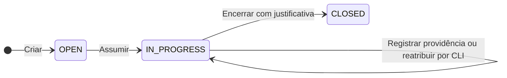
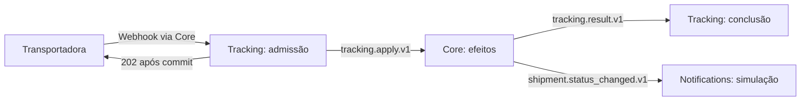

# FulfillFlow 2.0

## 1. Objetivo e escopo

FulfillFlow é uma central de operações logísticas para acompanhar pedidos, remessas e eventos de transportadoras e tratar ocorrências com responsável e histórico. O usuário consulta a operação, abre uma ocorrência vinculada à remessa, assume o atendimento, registra providências e encerra o caso com justificativa.

A v2.0 atende uma organização, com autenticação externa, autorização local e ocorrências manuais. Preserva Tracking assíncrono, notificações simuladas e simulador externo. Transferência comum, reabertura, notificações reais, regras automáticas, IA, importação em lote e multitenancy ficam fora desse escopo. A reatribuição administrativa excepcional assegura a continuidade de atendimentos.

## 2. Arquitetura

| Componente | Responsabilidade |
| --- | --- |
| **Core** | Entrada pública, interface, Orders, Shipments e Carriers. Ocorrências formam um módulo próprio, com atendimento e histórico. Acesso e sessões possuem responsabilidade técnica separada. |
| **Tracking** | Autenticação HMAC, adapters Alpha/Beta, admissão durável, coordenação dos eventos e timeline. |
| **Notifications** | Consumo de fatos de remessa, renderização e registro de notificações simuladas, com consultas próprias. |
| **Provedor OIDC** | Autenticação de pessoas. Keycloak é a referência local; permissões de negócio pertencem ao Core. |

Cada serviço de aplicação possui API, worker, banco PostgreSQL, credenciais e migrações próprios. Módulos do Core usam interfaces Python públicas; serviços se comunicam por contratos HTTP e AMQP, sem acesso ao banco ou imports de implementação alheios. Routers e templates não contêm regras de domínio.

A aplicação utiliza Python, FastAPI, PostgreSQL, SQLAlchemy async, Alembic, RabbitMQ, aio-pika e Jinja2/HTMX/Bootstrap com assets locais, sem SPA. Locks e imagens identificam as versões efetivas. `fulfillflow` mantém aplicação e Compose; `fulfillflow-infra` mantém implantação Kubernetes, configuração de ambientes e verificação operacional, com versionamento próprio. A portabilidade contempla PostgreSQL e OIDC compatíveis, sem exigir serviços Azure para execução local.

## 3. Identidade e permissões

O login utiliza OIDC Authorization Code com PKCE, validando assinatura, emissor, audiência, `state` e `nonce`. A identidade local é vinculada a `(issuer, subject)`; nome e e-mail são atributos. A autenticação no provedor não concede acesso automaticamente: a identidade precisa estar previamente habilitada no Core.

| Acesso | Permissões |
| --- | --- |
| **Leitor (`viewer`)** | Consultar pedidos, remessas, eventos, notificações, ocorrências e histórico. |
| **Operador (`operator`)** | Consultar; criar, confirmar e cancelar pedidos e criar/cancelar remessas conforme as regras existentes; criar e assumir ocorrências; registrar providências e encerrar aquelas sob sua responsabilidade. |
| **Administração por CLI** | Habilitar identidades, alterar papéis, bloquear acesso, revogar sessões e reatribuir excepcionalmente atendimentos. Rearmes técnicos permanecem nos comandos restritos do serviço proprietário. |

O cadastro de transportadoras conserva seu mecanismo administrativo, sem novo CRUD público. Identidades referenciadas no histórico não são apagadas. Alterações de acesso registram executor administrativo, alvo, ação, motivo e horário na mesma transação da alteração; essa auditoria é distinta do histórico de atendimento e dos logs técnicos.

Sessões opacas são persistidas no PostgreSQL apenas pelo hash do identificador, com validade absoluta padrão de oito horas, configurável e sem renovação por atividade. Cookies usam `HttpOnly`, `SameSite=Lax` e `Secure` em HTTPS. Logout invalida a sessão atual; bloqueio local invalida todas as sessões do usuário. Mudanças de papel valem nas operações seguintes, inclusive em sessões abertas.

Cada requisição verifica acesso no servidor. Nas mutações, a autorização mantém lock compartilhado sobre o usuário até o commit; revogação usa lock incompatível. Uma operação já autorizada pode concluir antes da revogação, mas nenhuma nova mutação é autorizada após sua confirmação. Usuários envolvidos são bloqueados em ordem estável, antes de sessão, recibo e ocorrência. Bloqueio no provedor não equivale a revogação local; sessões locais válidas continuam limitadas por sua expiração e pelas permissões atuais.

## 4. Ocorrências e transações

A ocorrência referencia uma Shipment existente, da qual obtém o pedido relacionado, sem copiar seu estado logístico. Uma remessa pode ter ocorrências distintas. O registro contém motivo, descrição, estado, responsável, versão e datas; seu histórico preserva autor, ação, conteúdo e horário, somente por acréscimo. IDs são estáveis, horários usam UTC e o relógio de domínio é injetável.

`OPEN` não possui responsável; assumir atribui o operador autenticado. Em `IN_PROGRESS`, somente o responsável registra providências e encerra. A administração pode reatribuir para outro operador habilitado, com justificativa, controle de versão e histórico, inclusive quando o responsável perde acesso. `CLOSED` é somente leitura. Encerrar não exige entrega da remessa nem altera pedido ou remessa; mudanças logísticas não encerram ocorrências, que podem ser abertas e atendidas mesmo após um estado logístico terminal.

Cada comando de ocorrência, inclusive a criação, exige `operation_id`. O recibo é único por usuário e operação e valida tipo de comando, recurso e hash do conteúdo; na criação, o recurso de entrada é a remessa. Após confirmar o acesso atual, a aplicação recupera uma repetição idêntica **antes** de validar `expected_version` ou reaplicar regras de transição. Reutilização divergente retorna 409. Uma criação nova não exige `expected_version`: confirma ocorrência, versão inicial, histórico e recibo juntos; sua repetição devolve o mesmo ID e resultado original, sem criar outro registro. Nos comandos de alteração, uma operação nova valida versão e regras sob lock da ocorrência e confirma alteração, incremento de versão, histórico e recibo na mesma transação. A reserva do recibo e suas constraints também protegem repetições concorrentes.

Orders, Shipments e Carriers preservam suas regras de domínio. Remessas pertencem a pedidos confirmados; a conclusão do pedido depende da entrega de todas as remessas não canceladas e da existência de pelo menos uma delas. Cancelamentos, transições terminais e ordenação dos eventos continuam independentes do atendimento das ocorrências.

## 5. Eventos e notificações

Core encaminha o webhook ao Tracking, preservando corpo e headers autenticados. Tracking valida HMAC-SHA256 antes de interpretar ou persistir o conteúdo e consulta o cadastro no Core durante a admissão. Para uma mesma transportadora, mesmo ID com bytes diferentes gera conflito; uma repetição idêntica reutiliza o trabalho e o resultado originais.

O webhook exige `Content-Type: application/json` e exatamente uma ocorrência de `X-FulfillFlow-Event-Id`, `X-FulfillFlow-Timestamp` e `X-FulfillFlow-Signature`. A assinatura usa o formato `sha256=<hex>` e HMAC-SHA256 sobre `timestamp + "." + event_id + "." + raw_body`, preservando os bytes originais, com segredo próprio por transportadora e comparação em tempo constante. O timestamp usa segundos Unix, com tolerância padrão de 300 segundos contra replay; o corpo tem limite padrão de 65.536 bytes. O ID externo é sensível a maiúsculas/minúsculas, aceita ASCII visível sem espaços laterais, tem até 128 caracteres e deve coincidir com o ID do payload. Simulador, verificador e Tracking utilizam esse mesmo contrato.

As mensagens entre etapas passam pelo RabbitMQ e são publicadas e consumidas pelos workers. A admissão confirma inbox, comando normalizado e outbox juntos antes do 202. Core confirma recibo, efeitos em remessa/pedido, outbox de resultado e, quando aplicável, outbox do fato na mesma transação. Tracking finaliza inbox e timeline localmente; Notifications confirma notificação e conclusão técnica em seu banco.

A recepção persiste a inbox técnica antes do ACK. Publicações usam mensagens persistentes, roteamento obrigatório e confirms; leases com token, recibos e hashes sustentam retomada e deduplicação. Nenhuma conexão ou transação SQL fica retida durante HTTP, publicação AMQP ou ACK. Falhas transitórias têm tentativas limitadas; bloqueios e quarentena exigem diagnóstico e recuperação explícita.

Notifications consome apenas `shipment.status_changed.v1`, gerado por mudança aplicada de estado, com destinatário capturado no Core e identidade vinculada ao evento de Tracking. Os resultados permanecem `SIMULATED` ou `FAILED`; não há envio externo nem publicação de ocorrências nesse contrato. Registros legados preservam sua origem e não geram novos envios.

Aceitação, efeitos logísticos, conclusão do Tracking e simulação da notificação são observações distintas. Fila vazia, ACK ou processo saudável não comprovam conclusão do negócio.

## 6. Interface, APIs e ferramentas

A página inicial apresenta ocorrências por estado, responsável e remessa. O detalhe reúne pedido, remessa, timeline, progresso da notificação e histórico do atendimento. Páginas e APIs compartilham casos de uso e permissões. HTMX atualiza regiões delimitadas sem sobrescrever formulários em edição; polling de pendências termina em resultado terminal, navegação ou prazo de observação, sem reenviar eventos. Falhas de consulta aparecem como indisponibilidade e preservam o último estado conhecido.

| Contrato | Rotas |
| --- | --- |
| Autenticação | `GET /auth/login`, `GET /auth/callback`, `GET /auth/session`, `POST /auth/logout` |
| Criação de ocorrência | `POST /api/v1/occurrences`, com `operation_id`, sem `expected_version`; repetição idêntica retorna o mesmo ID e resultado original. |
| Consulta de ocorrências | `GET /api/v1/occurrences`, `GET /api/v1/occurrences/{id}` e `/{id}/history` |
| Atendimento | `POST /api/v1/occurrences/{id}/assume`, `/{id}/notes` e `/{id}/close`, com `operation_id` e `expected_version` |
| Operações existentes | Rotas de pedidos, remessas, timeline, inbox e notificações mantêm seus contratos de domínio e passam a exigir sessão operacional. |
| Transportadoras | `POST /api/v1/carriers/{carrier_code}/events`, com HMAC independente da sessão de usuário. |

As respostas usam JSON, paginação determinística, timestamps ISO 8601, `X-Request-ID` e erros `application/problem+json`. O prefixo `/api/v1` permanece; a exigência de autenticação é uma mudança de acesso da v2.0. Mutações autenticadas por cookie, inclusive APIs JSON, exigem CSRF. Login, callback, assets e health checks possuem tratamento próprio; rotas internas conservam credenciais segregadas, sem receber cookies dos usuários.

Demonstração, testes e verificador utilizam um auxiliar de autenticação que percorre o login OIDC real pelo navegador, manualmente ou de forma automatizada para usuários sintéticos habilitados. Após o callback, as ferramentas reutilizam o cookie de sessão em um cookie jar protegido. A sessão é obtida novamente por login após expiração ou logout, sem renovação silenciosa pelo polling nem troca do fluxo por autenticação direta com senha na aplicação.

`GET /auth/session` exige sessão válida e retorna `expires_at` e `csrf_token`, vinculado à sessão, sem expor seu identificador. A resposta usa `Cache-Control: no-store`, não prolonga a sessão e não permite leitura por CORS de outra origem. APIs JSON e chamadas HTMX enviam o token em `X-CSRF-Token`; formulários podem enviá-lo no campo `csrf_token`. Sessão ausente, expirada ou revogada retorna 401 nas APIs; permissão insuficiente ou CSRF inválido retorna 403. Reautenticação não repete automaticamente uma mutação de resultado incerto.

O simulador envia o webhook apenas com HMAC, sem exigir sessão ou CSRF nessa chamada. Preparação de pedidos/remessas exige sessão de operador e CSRF; consultas de conclusão, inclusive ao endereço de `Location`, usam sessão com permissão de leitura, sem CSRF. Sessões e tokens ficam em memória ou armazenamento temporário restrito, fora do Git, sem exposição em argumentos ou logs. Não há desvio de autenticação nem uso externo do token interno dos serviços.

## 7. Execução e atualização

Compose executa os três serviços, seus workers, PostgreSQL, RabbitMQ e Keycloak. Apenas Core e o acesso de login do provedor publicam portas locais em loopback; bancos, broker e APIs internas ficam privados. O provedor possui persistência e credenciais próprias. URLs de emissor e callback são coerentes entre navegador e contêineres. Fora do ambiente local, as entradas usam HTTPS e segredos fornecidos pelo ambiente.

A preparação idempotente cria usuários e operações sintéticas. Alembic controla os schemas; aplicações não criam tabelas no startup. A v2.0 usa recursos próprios e preserva tags, commits e evidências 1.x. Migrações são verificadas em bancos novos e, quando houver migração de dados, em cópias descartáveis da base correspondente, sem fabricar histórico, atores ou eventos.

Kubernetes utiliza aplicação explícita de manifests Kustomize versionados, imagens identificadas por digest e verificação funcional autenticada. A atualização interrompe novas admissões e escritores de forma controlada, aplica migrações, inicia a referência candidata e verifica o fluxo. Workers encerram com prazo limitado, preservando trabalho retomável. O procedimento admite manutenção e não depende de coexistência entre versões.

Recuperar configuração, voltar uma imagem e reverter banco são procedimentos distintos. Uma imagem anterior só é retomada se compatível com o schema vigente; falha de implantação não aciona downgrade destrutivo automático.

| Recursos e campos | Responsável | Regra de atualização |
| --- | --- | --- |
| Templates dos workloads, incluindo imagens, ambiente, recursos e probes; ConfigMaps e referências de Secrets | Manifests versionados | Alterações persistentes entram no overlay; intervenção temporária registra a configuração anterior e sua restauração. |
| `spec.replicas` dos workloads sem autoescalonamento, incluindo `core-worker` no perfil fixo | Manifests versionados | A quantidade segue o perfil do ambiente; mudanças temporárias são restauradas ao final da intervenção. |
| `core-worker.spec.replicas` no perfil escalonado, com mínimo de uma réplica | HPA gerenciado pelo KEDA | O overlay omite esse campo; aplicação de manifests e scripts de entrega não impõem contagem paralela. |
| Política do ScaledObject e configuração do HPA correspondente | Política nos manifests; HPA gerado pelo KEDA | Limites e sinais são alterados no ScaledObject, sem edição direta do HPA gerado. Campos de status e recursos derivados pertencem aos controladores. |

A passagem do perfil fixo para o escalonado transfere a propriedade de `spec.replicas`, incluindo o registro de aplicação anterior, sem reduzir inadvertidamente a contagem. Intervenções no alvo escalonado utilizam pausa pelo ScaledObject, com `autoscaling.keda.sh/paused-replicas` para fixar a quantidade desejada, e aguardam a pausa e a convergência antes de prosseguir. Ao terminar, removem a pausa, restauram a política versionada e conferem a retomada do escalonamento e o resultado funcional. Os demais workloads mantêm réplicas fixas.

## 8. Observabilidade e aceite

Logs e consultas de diagnóstico correlacionam usuário, ocorrência, operação e evento, sem segredos, cookies ou corpos completos. Histórico de atendimento e auditoria de acesso permanecem consultáveis independentemente dos logs. A instrumentação HTTP existente é preservada; cobertura de novos fluxos depende de instrumentação explícita. Saúde de API, worker, dependências e trabalho bloqueado são sinais distintos; readiness confere banco e schema.

O aceite exige jornada autenticada completa, permissões no servidor, recusa de identidade não habilitada, revogação concorrente, idempotência antes do conflito de versão, reatribuição auditada, rollback e retomada sem duplicação. As verificações usam PostgreSQL, RabbitMQ e provedor OIDC reais nas fronteiras pertinentes e preservam regressões dos fluxos logísticos. Incluem simulador/verificador autenticados, migrações, build, interface e gates de pytest, Ruff, Mypy e Import Linter. A demonstração comprova atendimento e histórico sem alteração indevida de pedido ou remessa.

## 9. Referências

- [Gestão de transportes — Microsoft Dynamics 365](https://learn.microsoft.com/en-us/dynamics365/supply-chain/transportation/transportation-management-overview): referência de domínio para pedidos, remessas e operações de transporte.
- [OpenID Connect Core](https://openid.net/specs/openid-connect-core-1_0.html) e [integração OIDC no Keycloak](https://www.keycloak.org/securing-apps/oidc-layers): autenticação, identidade e integração com o provedor.
- [OWASP — prevenção de CSRF](https://cheatsheetseries.owasp.org/cheatsheets/Cross-Site_Request_Forgery_Prevention_Cheat_Sheet.html): vinculação e transmissão de tokens nas operações autenticadas por sessão.
- [PostgreSQL — bloqueios explícitos](https://www.postgresql.org/docs/18/explicit-locking.html): concorrência e coordenação entre operações e revogação.
- [Transactional Outbox](https://microservices.io/patterns/data/transactional-outbox.html) e [RabbitMQ — confirms e acknowledgements](https://www.rabbitmq.com/docs/confirms): persistência local, publicação e confirmação de transporte.
- [HTMX — polling](https://htmx.org/docs/#polling): atualização parcial e observação limitada de processamento.
- [Kubernetes Kustomize](https://kubernetes.io/docs/tasks/manage-kubernetes-objects/kustomization/), [HPA](https://kubernetes.io/docs/concepts/workloads/autoscaling/horizontal-pod-autoscale/) e [KEDA — pausa escalonamento](https://keda.sh/docs/2.20/concepts/scaling-deployments/#pausing-autoscaling): aplicação de manifests, propriedade de réplicas e intervenção operacional.
