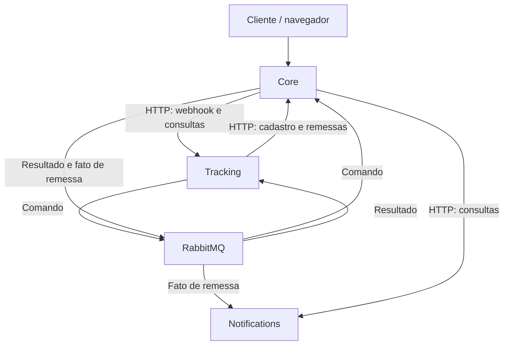

# FulfillFlow 1.x

## 1. Objetivo e referência

FulfillFlow acompanha pedidos, remessas e atualizações de entrega de transportadoras simuladas. A interface permite criar e consultar operações, observar o processamento de eventos e consultar notificações simuladas. O fluxo distingue a aceitação de um evento, a confirmação dos efeitos de negócio, a conclusão do Tracking e a simulação da notificação.

Este documento consolida a arquitetura da `v1.3.0-rc.1` (`9e3a135`) e a extensão HTTP de observabilidade (`045e1ca`), incorporando os contratos ainda vigentes das versões anteriores. A consolidação não cria uma release estável nem modifica as referências históricas. Os links ao final identificam as fontes completas.

O recorte inclui Orders, Shipments, Carriers, Tracking, Notifications, interface operacional e simulador externo. Gestão de ocorrências, autenticação de usuários, permissões por usuário, multitenancy, envio real de mensagens, integração real com transportadoras e recursos de IA pertencem a evoluções posteriores.

## 2. Arquitetura e responsabilidades

São três serviços de aplicação, cada um com API, worker, banco, credencial e histórico de migração próprios. Os módulos de negócio do Core permanecem no mesmo serviço. A execução local utiliza uma instância PostgreSQL e um RabbitMQ compartilhados, com segregação lógica de acesso. O Compose define três referências de imagem, uma por serviço, construídas pelo mesmo Dockerfile e alvo `runtime`. A API, o worker e as migrações de cada serviço compartilham sua referência de imagem; isso não implica conteúdos binários distintos nem exige repositórios separados.

| Serviço | Responsabilidades | Persistência |
| --- | --- | --- |
| Core | Entrada pública, interface, pedidos, remessas, cadastro de transportadoras, aplicação de comandos e composição de consultas | Orders, Shipments, Carriers, recibos idempotentes, inbox técnica, outboxes e quarentena |
| Tracking | Autenticação dos webhooks, adapters, normalização, admissão, coordenação e timeline | Inbox de negócio, comando imutável, TrackingEvents, outbox, inbox técnica e quarentena |
| Notifications | Recepção de fatos de remessa, renderização, simulação de notificação e consultas | Notifications, inbox técnica, quarentena e auditoria de rearme; sem outbox |

No diagrama, Core, Tracking e Notifications representam serviços e agrupam suas APIs e workers. Os workers realizam as publicações e os consumos AMQP. A interface é servida pelo Core.

Somente a API Core publica porta de aplicação no host. As APIs internas e o broker permanecem na rede privada do Compose. Workers são processos separados, sem servidor HTTP. Core consulta Notifications quando precisa apresentar seus dados, sem manter uma réplica local nem receber callback de conclusão.

Cada serviço acessa apenas seu banco. Não há joins, chaves estrangeiras, sessões SQL ou imports de implementação entre serviços. Dentro do Core, a comunicação entre módulos usa interfaces Python públicas. DTOs em `contracts` independem de ORM e transporte; `shared` reúne primitivas técnicas, como relógio, IDs e paginação, sem regras de negócio. Routers e templates não contêm regras de domínio, e `domain.py` não depende de FastAPI, SQLAlchemy ou observabilidade.

## 3. Tecnologias e execução

| Camada | Componentes |
| --- | --- |
| Aplicação | Python 3.13, FastAPI, Uvicorn, Pydantic v2 e pydantic-settings |
| Persistência | PostgreSQL 18, SQLAlchemy async, psycopg 3 e Alembic |
| Mensageria | RabbitMQ 4.2.4 e aio-pika 9.5.8 na referência documentada |
| Interface | Jinja2, HTMX e Bootstrap locais, sem SPA ou toolchain Node |
| Empacotamento | uv, lock versionado, Docker e Docker Compose |
| Qualidade | pytest, Ruff, Mypy, Import Linter e GitHub Actions |
| Observabilidade | Logs estruturados dos workers, diagnóstico local e extensão HTTP opcional com OpenTelemetry |

O `uv.lock` e os digests das imagens da referência fixam as versões efetivas. Kubernetes, Terraform, KEDA e a implantação Azure são tratados no repositório de infraestrutura, sem se tornarem requisitos para executar a aplicação localmente.

## 4. Domínio e propriedade dos dados

| Entidade | Informações principais e invariantes |
| --- | --- |
| Order | Referência externa única, destinatário sintético, estado e datas. Possui zero ou mais remessas |
| Carrier | Código único e imutável, nome, situação ativa e chave de adapter. Segredos não ficam no cadastro |
| Shipment | Pedido, transportadora, código de rastreamento, estado, datas logísticas e chave temporal do último evento determinante. Unicidade por `(carrier_id, tracking_code)` |
| CarrierEventInbox | ID externo, transportadora, bytes originais, hash, projeção JSON, correlação e estado de processamento. Unicidade por `(carrier_id, external_event_id)` |
| TrackingEvent | Evento canônico, remessa, horários, resultado e estados anterior/posterior. Histórico somente de acréscimo, com no máximo um registro por inbox |
| Recibo Core | Identidade estável do comando, hash, decisão e resultado original. A reserva da identidade e os efeitos são confirmados juntos |
| Notification | Identidade do efeito, remessa, destinatário capturado, canal, template, mensagem e resultado simulado. Unicidade por `tracking_event_id` |

UUIDs e timestamps usam tipos nativos do PostgreSQL, com horários em UTC. Estados usam texto com restrições nomeadas. Chaves estrangeiras existem somente dentro do banco proprietário; IDs de outros serviços são referências externas. O histórico de negócio não é removido por exclusão em cascata. O tempo de domínio vem de um `Clock` injetável.

`tracking_code` é normalizado com remoção de espaços laterais e conversão para maiúsculas. O ID externo do evento é sensível a maiúsculas/minúsculas, aceita ASCII visível sem espaços laterais e tem limite de 128 caracteres. `raw_body` preserva os bytes autenticados; `parsed_payload` é apenas uma projeção de consulta.

### Pedidos e remessas

Order permite `CREATED → CONFIRMED → FULFILLED` e `CREATED → CANCELLED`. Remessas são criadas somente para pedidos confirmados. Um pedido é concluído quando existe ao menos uma remessa não cancelada e todas as remessas não canceladas estão entregues. Essa condição é reavaliada na entrega ou no cancelamento de uma remessa, sob os locks correspondentes. Confirmar um pedido já confirmado ou cancelar um já cancelado é idempotente; outras ações incompatíveis retornam conflito.

| Estado da remessa | Próximos estados permitidos |
| --- | --- |
| `PENDING` | `POSTED`, `IN_TRANSIT`, `OUT_FOR_DELIVERY`, `DELIVERED`, `EXCEPTION`, `CANCELLED` |
| `POSTED` | `IN_TRANSIT`, `OUT_FOR_DELIVERY`, `DELIVERED`, `EXCEPTION`, `RETURNED` |
| `IN_TRANSIT` | `OUT_FOR_DELIVERY`, `DELIVERED`, `EXCEPTION`, `RETURNED` |
| `OUT_FOR_DELIVERY` | `IN_TRANSIT`, `DELIVERED`, `EXCEPTION`, `RETURNED` |
| `EXCEPTION` | `IN_TRANSIT`, `OUT_FOR_DELIVERY`, `DELIVERED`, `RETURNED` |
| `DELIVERED`, `RETURNED`, `CANCELLED` | Nenhum |

A remessa começa em `PENDING`. Cancelamento manual é permitido nesse estado e é idempotente em `CANCELLED`; não cria evento de transportadora, timeline ou notificação. Eventos externos não produzem `CANCELLED`. Saltos previstos na tabela acomodam eventos intermediários ausentes. `shipped_at` recebe o horário do primeiro evento aplicado de movimento logístico, inclusive entrega ou devolução; `EXCEPTION` isolado não comprova postagem. `delivered_at` recebe o horário da entrega aplicada.

### Ordenação e resultado

A aplicação ordena eventos pela tupla `(occurred_at, received_at, external_event_id)`. No `PENDING` inicial, o primeiro evento válido não é considerado atrasado apenas por anteceder a criação da remessa. Depois dele, uma chave anterior produz `IGNORED_STALE`. Um estado repetido com chave posterior produz `NO_STATE_CHANGE` e atualiza a chave temporal, sem notificar nem reavaliar o pedido. Uma transição não permitida produz `IGNORED_INVALID_TRANSITION`. Uma alteração válida produz `APPLIED`.

Os quatro resultados integram a timeline sem regredir o estado da remessa. Rejeições permanentes, como remessa não localizada, finalizam o inbox como `REJECTED`, sem TrackingEvent. A rejeição persistida no recibo não muda se a remessa for criada posteriormente.

## 5. Entrada de eventos e adapters

O webhook público é `POST /api/v1/carriers/{carrier_code}/events`. Core encaminha os bytes e headers relevantes ao Tracking. A admissão depende da consulta ao cadastro de Carrier no Core; a arquitetura assíncrona não elimina essa dependência HTTP.

Tracking exige `Content-Type: application/json` e exatamente uma ocorrência de `X-FulfillFlow-Event-Id`, `X-FulfillFlow-Timestamp` e `X-FulfillFlow-Signature`. A assinatura é HMAC-SHA256 de `timestamp + "." + event_id + "." + raw_body`, com comparação em tempo constante, segredo próprio por transportadora e validação antes de parsing ou persistência. O timestamp usa segundos Unix, com tolerância padrão de 300 segundos; o corpo tem limite padrão de 65.536 bytes. O ID do payload deve coincidir com o header autenticado.

Os adapters Alpha e Beta pertencem ao Tracking e são selecionados por uma lista estática de implementações permitidas. Eles validam e normalizam o payload sem consultar banco ou alterar o estado de negócio. O contrato canônico contém `external_event_id`, `tracking_code`, `canonical_status`, `external_status`, `occurred_at`, `description` e `location`. O horário externo deve incluir fuso; campos adicionais do fornecedor permanecem apenas no registro bruto e na projeção JSON.

| Estado canônico | Carrier Alpha | Carrier Beta |
| --- | --- | --- |
| `POSTED` | `CREATED` | `label_created` |
| `IN_TRANSIT` | `MOVING` | `hub_scan` |
| `OUT_FOR_DELIVERY` | `OUT_FOR_DELIVERY` | `courier_route` |
| `DELIVERED` | `DELIVERED` | `completed` |
| `EXCEPTION` | `PROBLEM` | `delivery_issue` |
| `RETURNED` | `RETURNED` | `returned_origin` |

O comando `ApplyEventCommand` recebe identidade determinística vinculada ao UUID do inbox e hash canônico que inclui conteúdo, hash bruto e ordenação. Depois de persistido, o comando é imutável. Mesmo ID externo e mesmos bytes reutilizam o trabalho original; mesmo ID e bytes diferentes produzem conflito, sem sobrescrita.

## 6. Fluxo e transações locais

| Etapa | Confirmação local e consequência |
| --- | --- |
| Admissão no Tracking | Grava inbox de negócio `RECEIVED`, comando normalizado e outbox juntos. Após o commit, responde 202 sem aguardar o broker |
| Publicação do comando | Tracking publica `tracking.apply.v1` a partir da outbox; a confirmação do broker permite registrar `SENT` |
| Recepção no Core | Persiste a mensagem na inbox técnica antes do ACK. O processamento pode ocorrer depois |
| Aplicação no Core | Confirma recibo, efeitos em Shipment/Order, outbox de resultado, outbox de fato quando `APPLIED` e inbox técnica `DONE` na mesma transação |
| Finalização no Tracking | Após recepção durável do resultado, confirma timeline, finalização do inbox de negócio e inbox técnica `DONE` em transação local |
| Recepção em Notifications | Persiste o fato na inbox técnica antes do ACK, independentemente da finalização do Tracking |
| Simulação em Notifications | Confirma o registro de notificação e a inbox técnica `DONE` juntos |

Cada coordenador controla sua transação; repositories não confirmam parcialmente a unidade de trabalho. A aplicação usa `READ COMMITTED`, restrições de unicidade e locks reais. No Core, o lock de Shipment precede o de Order. Nenhuma conexão, transação ou lock SQL permanece retido durante HTTP, publicação AMQP ou ACK. A aplicação de comandos usa mensageria, sem endpoint ou fallback HTTP síncrono para esse processamento.

Falha ao gravar uma outbox local reverte os demais efeitos daquela transação. Indisponibilidade do destinatário é tratada posteriormente pelo transporte. Recibos repetidos devolvem a decisão original, sem recalcular efeitos, destinatários ou horários. Tracking valida identidade e hash do comando ao aplicar o resultado; uma conclusão divergente não substitui a anterior.

A ordem de chegada entre o resultado Tracking e o fato Notifications é livre. Shipment e Order podem estar atualizados enquanto Tracking ou Notifications ainda têm pendências. Cada etapa possui atomicidade local; não existe commit distribuído nem uma fotografia global atômica do fluxo.

## 7. Mensagens e transporte durável

| Tipo | Origem → destino | Conteúdo e identidade |
| --- | --- | --- |
| `tracking.apply.v1` | Tracking → Core | `ApplyEventCommand`, com identidade e ordenação originais |
| `tracking.result.v1` | Core → Tracking | `command_sha256` e resultado aplicado ou rejeitado, preservando a decisão original |
| `shipment.status_changed.v1` | Core → Notifications | `shipment_id`, `resulting_status` e `recipient` capturado durante a aplicação; `event_id` corresponde à identidade do efeito |

Os envelopes contêm `schema_version`, `type`, `message_id`, `event_id`, `correlation_id`, `causation_id`, `request_id`, `created_at`, `payload` e `payload_sha256`. `correlation_id` identifica o inbox original. No comando, `causation_id` é o inbox; no resultado e no fato de remessa, é a mensagem de comando. IDs são criados uma vez e persistidos. A serialização é canônica, usa UTC, rejeita campos adicionais e limita o envelope a 64 KiB em UTF-8. Propriedades AMQP e envelope devem corresponder. Hash verifica conteúdo; autenticação do remetente depende das credenciais do transporte.

O RabbitMQ usa três fluxos com exchanges direct e filas classic duráveis, em nó único, sem exclusive ou auto-delete. O fluxo de Notifications usa exchange `shipment.status_changed.v1`, fila `shipment.status_changed.v1.queue` e routing key igual ao tipo, sem TTL. Bindings são declarados antes da publicação. Vhost e permissões distinguem os serviços; AMQP e management não ficam expostos no host no ambiente padrão.

### Publicação e recepção

Outboxes existem apenas no Core e no Tracking, com unicidade por `(type, event_id)`. Seus estados são `PENDING`, `LEASED`, `SENT` e `BLOCKED`, com tentativa, prazo, token de posse e motivo. O publicador reserva lotes com `FOR UPDATE SKIP LOCKED`, confirma a reserva, libera a sessão e publica mensagens persistentes com `mandatory` e publisher confirms. Somente confirmação positiva sem retorno permite marcar `SENT`, condicionada ao token vigente. Uma posse expirada pode ser retomada; o proprietário antigo não sobrescreve a nova.

Timeout, retorno de roteamento ou perda de confirmação podem exigir republicação da mesma mensagem. A recepção verifica `message_id`, identidade lógica e hash. Duplicatas idênticas não repetem efeitos; divergências preservam o original e geram diagnóstico. O ACK ocorre depois da persistência técnica, não depois da conclusão de negócio. Se o commit da recepção for incerto, o consumidor não confirma e reconecta, permitindo nova entrega idempotente.

No Core, os publicadores de resultado Tracking e fato Notifications têm seleção por tipo antes do limite do lote, canais e esperas independentes. Backlog ou falha controlada de um fluxo não ocupa a seleção do outro. Ambos continuam compartilhando processo, banco e broker.

### Tentativas e recuperação

Inboxes técnicas usam `PENDING`, `RETRY_WAIT`, `DONE` e `BLOCKED`. Falha transitória de um item permite cinco tentativas por geração, com intervalos de 1, 5, 15 e 60 segundos. Tentativas e prazos são persistidos. Esgotamento ou erro inesperado bloqueia o item; rejeição de negócio produz resultado terminal. Savepoints permitem registrar tentativas sem confirmar efeitos parciais. Perda da conexão reverte a transação inteira e deixa o trabalho retomável.

Indisponibilidade global de banco ou broker pausa o componente com espera progressiva limitada a 30 segundos, sem esgotar rapidamente as tentativas de cada item. Mensagens inválidas, desconhecidas ou conflitantes são preservadas em quarentena durável e limitada antes do ACK. Falha ao registrar a quarentena não autoriza descarte silencioso.

O reinício dos workers permite retomar trabalho persistido, inclusive após ACK e com a fila do broker vazia. Itens `BLOCKED` exigem rearme pelo CLI do serviço proprietário, com ID, hash esperado, banco alvo e motivo. O rearme cria uma geração auditável sem alterar payload ou identidade; não reprocessa `DONE` nem reenfileira quarentena automaticamente. A recuperação depende da disponibilidade dos processos e armazenamentos, sem garantia contra perda permanente de disco.

## 8. Notificações simuladas

Uma notificação é gerada somente para uma transição de Tracking com resultado `APPLIED`. `NO_STATE_CHANGE`, `IGNORED_STALE`, `IGNORED_INVALID_TRANSITION`, rejeições, duplicatas, criação de remessa, cancelamento manual e conclusão do pedido por si só não geram notificação.

O destinatário é capturado do pedido na transação Core e segue no fato, com limite de 254 caracteres. Notifications não consulta o pedido para atualizá-lo. O serviço define o canal `EMAIL` e o template determinístico; não recebe o corpo bruto da transportadora. A identidade lógica é `tracking_event_id`, correspondente ao `event_id` do fato. Eventos aplicados distintos geram registros distintos, mesmo referentes à mesma remessa ou ao mesmo estado em momentos diferentes.

O resultado é `SIMULATED` ou `FAILED`. Sucesso registra `created_at` e `simulated_at` durante a simulação. Falha esperada de renderização registra `FAILED`, detalhe sanitizado e `simulated_at=null`; também conclui a inbox técnica. Falhas operacionais permanecem no mecanismo de tentativa/bloqueio e não são convertidas em `FAILED` de negócio. Registros terminais não são simulados novamente.

Notifications não é um serviço genérico de envio: aceita o fato de remessa definido acima e não integra SMTP, API de e-mail ou outro provedor externo. A garantia demonstrada é um registro simulado por efeito, sustentado por transações e unicidade locais. Envio real acrescentaria outra fronteira de confirmação e requer contrato próprio.

## 9. API e consultas

As APIs públicas usam `/api/v1`, JSON UTF-8, campos em `snake_case`, timestamps ISO 8601 com fuso e paginação por `page` e `page_size` (padrão 25, máximo 100). Erros seguem `application/problem+json`, com código estável e detalhe sanitizado, inclusive validação, 404 e 405. Todas as respostas propagam um `X-Request-ID` válido ou gerado pela aplicação.

| Operação | Rotas públicas |
| --- | --- |
| Pedidos | `POST/GET /api/v1/orders`; `GET /api/v1/orders/{order_id}`; `POST /api/v1/orders/{order_id}/confirm` e `/cancel` |
| Remessas | `POST/GET /api/v1/shipments`; `GET /api/v1/shipments/{shipment_id}`; `POST /api/v1/shipments/{shipment_id}/cancel` |
| Timeline | `GET /api/v1/shipments/{shipment_id}/tracking` |
| Admissão de evento | `POST /api/v1/carriers/{carrier_code}/events` |
| Inbox de negócio | `GET /api/v1/carrier-events` e `/api/v1/carrier-events/{inbox_event_id}` |
| Notificações | `GET /api/v1/notifications` e `/api/v1/notifications/{notification_id}` |
| Progresso da notificação | `GET /api/v1/notification-status/{tracking_event_id}` |
| Saúde | `GET /health/live` e `/health/ready` |

### Aceitação e conclusão do evento

| Condição | Resposta |
| --- | --- |
| Evento novo admitido | 202 após commit local, mesmo que o processamento termine antes de a resposta chegar |
| Mesmo ID e hash ainda pendentes | 202 com referência ao inbox original |
| Mesmo ID e hash já processados | 200, `DUPLICATE` e resultado original |
| Mesmo ID e hash rejeitados | Erro permanente original, sem novo trabalho |
| Mesmo ID com bytes diferentes | 409, sem sobrescrever o original |
| Carrier desconhecido/inativo; autenticação inválida; corpo excessivo; mídia inválida | 404, 401, 413 ou 415, respectivamente, sem persistência de admissão |
| JSON, schema, status externo ou ID inválidos após autenticação | 422 e inbox `REJECTED`, sem comando para aplicação |
| Falha de infraestrutura durante a admissão | 503 sanitizado; confirmação incerta não comprova ausência de efeitos |

A resposta 202 contém `inbox_event_id`, `external_event_id`, `status=RECEIVED`, `received_at` e `request_id`. `Location` aponta à consulta do inbox e `Retry-After: 1` orienta a observação. O trabalho preserva a correlação original; a resposta usa a correlação da requisição atual. Um reenvio com mesmo ID e mesmos bytes pode esclarecer uma admissão incerta, mantendo a autenticação válida.

A consulta apresenta `RECEIVED`, `PROCESSED` ou `REJECTED`, resultado terminal, `tracking_event_id` quando aplicável e `completed_at`. O progresso local distingue `QUEUED`, `AWAITING_RESULT`, `COMPLETED` e `BLOCKED_LOCAL`; ele não representa uma visão sincronizada do Core. `processed_at` preserva a decisão original e `completed_at` registra a finalização no Tracking, sem representar o instante exato do commit. Rejeições posteriores ao 202 aparecem na consulta; não alteram a resposta já enviada.

A admissão pode funcionar com o broker indisponível se Core, Tracking e os bancos necessários estiverem acessíveis. O trabalho acumula na outbox, sujeito à capacidade disponível. A adoção de 202 desde a v1.2 alterou a semântica dos clientes síncronos anteriores, embora o prefixo `/api/v1` tenha permanecido.

### Consulta de notificação

A lista de Notifications contém registros terminais, com filtros por `status`, `shipment_id` e intervalo de criação inclusivo, ordenados por `created_at DESC, id DESC`. Lista vazia não representa ausência de trabalho pendente. Falha na consulta remota retorna 503 sanitizado, sem fallback para tabela histórica, zero artificial ou 404 inventado.

O progresso por `tracking_event_id` combina leituras identificadas por horário. Core consulta recibo e outbox localmente, encerra a transação e consulta Notifications quando necessário. Recibo inexistente retorna 404; resultado sem notificação retorna `required=false`. Para `APPLIED`, a resposta separa publicação (`PENDING/LEASED/SENT/BLOCKED`), processamento (`NOT_RECEIVED/PENDING/RETRY_WAIT/BLOCKED/DONE`), registro terminal e origem `ASYNC/LEGACY`. `core_observed_at` e `notifications_observed_at` indicam os instantes de observação.

Uma conclusão remota pode aparecer antes de a publicação local ser marcada como `SENT`. Um registro importado `LEGACY` mantém seu resultado original sem inventar progresso técnico. Para efeito `APPLIED` sem outbox, somente um registro explicitamente importado justifica essa variante; ausência remota ou registro `ASYNC` nessa situação é erro de integridade.

## 10. Interface e simulação

A interface é renderizada no servidor e navega por Dashboard, Orders, Shipments, Inbox, Notifications e Simulator. Páginas e requisições HTMX usam os mesmos casos de uso. O detalhe do pedido reúne suas remessas; timeline, inbox e notificações oferecem consultas sanitizadas. Templates não interpretam regras de transição nem importam persistência.

A interface diferencia evento aceito, resultado Tracking e notificação simulada. A observação de pendências consulta a cada segundo por até 30 segundos e termina em conclusão, rejeição, bloqueio aplicável, navegação ou prazo. Uma nova observação somente consulta, sem reenviar evento ou rearmar trabalho. Em erro de consulta, preserva o último estado conhecido. O dashboard apresenta contagens remotas indisponíveis como indisponíveis, sem convertê-las em zero.

O simulador de transportadoras executa fora da aplicação, pelo webhook público. Oferece cenários de evento válido, duplicidade, ordem invertida, status desconhecido e assinatura inválida para Alpha e Beta. Separa aceitação e conclusão, consulta `Location` e usa prazo configurável. A conclusão do cenário de Tracking não comprova a simulação de Notifications, que tem consulta própria. A tela Simulator documenta o uso do cliente externo.

## 11. Segurança e exposição

A linha 1.x é destinada ao ambiente controlado e não possui login, SSO ou autorização de usuários. Formulários mutáveis usam sessão assinada, CSRF e Post/Redirect/Get. APIs JSON e webhooks permanecem sem cookies de sessão. Assets são locais e compatíveis com a política de segurança de conteúdo; CORS fica desabilitado por padrão.

Rotas internas sob `/internal/v1` exigem um único `X-FulfillFlow-Internal-Token`, comparado em tempo constante. Core/Tracking usam seu segredo compartilhado; Core/Notifications possuem outro segredo. HMAC fica no Tracking e o segredo da sessão HTML fica no Core. O token interno não substitui a autenticação da transportadora. Cada processo recebe apenas o DSN e as credenciais que lhe pertencem.

Timeouts HTTP padrão são 30 segundos para encaminhamento ao Tracking, 10 segundos para chamadas ao Core e 2 segundos para consultas a Notifications, estas sem retry automático. URLs internas vêm de configuração, sem destinos arbitrários fornecidos pelo cliente. Não há endpoint público para rearme administrativo. Credenciais, assinaturas, destinatários, corpos completos e exceções brutas não são expostos em logs ou respostas.

## 12. Operação, dados e migrações

O projeto Compose `fulfillflow-v13` usa volumes próprios, bancos `fulfillflow_core`, `fulfillflow_tracking` e `fulfillflow_notifications` e roles segregadas. Jobs aplicam as migrações antes das aplicações. Os heads da referência funcional são `1301_core`, `1203_tracking` e `1301_notifications`. Alembic é responsável pelo schema; APIs e workers não criam tabelas no startup.

| Processo | CPU | Memória | Pool SQL / overflow |
| --- | --- | --- | --- |
| Cada API: Core, Tracking ou Notifications | 0,5 | 384 MiB | 2 / 0 |
| Cada worker: Core, Tracking ou Notifications | 0,5 | 384 MiB | 3 / 0 |
| PostgreSQL | 2 | 2560 MiB | Não aplicável |
| RabbitMQ | 0,5 | 512 MiB | Não aplicável |

Esses limites correspondem ao ambiente funcional local, totalizando 5,5 CPUs e 5376 MiB, sem jobs e ferramentas auxiliares. Cada worker usa um processo, prefetch 8, lote de publicação 20 por publicador, consulta local de pendências a cada 500 ms, lease de 30 segundos e prazo de confirmação de 5 segundos. O encerramento gracioso aguarda até 15 segundos; Compose concede 20 segundos. Falha inesperada de um loop obrigatório encerra o processo, em vez de deixá-lo parcialmente ativo.

`/health/live` não consulta banco. `/health/ready` verifica acesso SQL e head do schema, retornando 503 se indisponíveis; o startup falha quando esses requisitos não são atendidos. Workers têm heartbeat atualizado a cada 500 ms e healthcheck local sem HTTP. Arquivo com mais de 5 segundos ou loop sem atividade por 45 segundos invalida a saúde. Saúde da API, saúde dos workers, dependência indisponível e trabalho bloqueado são observações distintas.

A identidade do nó RabbitMQ deve permanecer estável ao reutilizar o volume. Scripts e ensaios operam em recursos isolados; volumes e imagens históricos são preservados. Alterar variáveis de senha não altera automaticamente credenciais já criadas em bancos ou broker.

### Corte e legado

A migração de Notifications da v1.2 para a v1.3 é offline, executada em cópias descartáveis durante sua verificação. Suspende novos escritores, drena o trabalho retomável, resolve bloqueios e exporta/importa registros pelos respectivos proprietários. Preserva IDs, destinatários, mensagens, estados, erros e horários. A importação é idempotente; divergências interrompem o procedimento. A tabela antiga no Core permanece arquivada e fora do runtime.

Registros importados usam `LEGACY`, sem envelopes ou tentativas históricos inventados. Se um fato chegar para um efeito já importado, o serviço preserva a notificação, registra `LEGACY_EVENT_SUPPRESSED` em quarentena e conclui a inbox técnica na mesma transação, sem nova simulação. A ausência de outbox em recibo legado não autoriza fabricar uma publicação.

Inboxes anteriores à adoção de outbox, ainda `RECEIVED` e sem trabalho técnico, são identificadas como legado pendente, com progresso nulo. Migrações não as publicam automaticamente. O corte não promete atualização online, convivência de escritores antigos/novos ou rollback de schema após novos eventos.

## 13. Observabilidade

Workers emitem logs JSON com horário UTC, serviço, etapa, identidades, tentativa, duração, resultado e categoria controlada de erro. O diagnóstico local apresenta contagens e idade das pendências, bloqueios, gerações, motivos, atividade e correlação por ID. Outbox, inbox técnica, fila do broker e inbox de negócio representam etapas diferentes; suas contagens não são somadas como eventos únicos.

O ACK transfere a recuperação para a persistência técnica. Por isso, fila vazia, publicação `SENT`, HTTP 202 ou processo saudável não bastam para confirmar o resultado de negócio. A conclusão é verificada pelos registros e consultas da etapa correspondente. O prefetch limita mensagens sem ACK, não o trabalho acumulado no PostgreSQL.

### Extensão HTTP opcional

A referência `045e1ca` acrescenta OpenTelemetry desabilitado por padrão (`OTEL_ENABLED=false`). Quando ativado em Core e Tracking, cobre somente a listagem `GET /api/v1/carrier-events` e sua consulta interna `/internal/v1/tracking/carrier-events`, com servidor Core, cliente HTTP interno e servidor Tracking. Um observador pode fornecer o span pai por `traceparent`; o trace não substitui request ID ou identidade de negócio.

A exportação usa OTLP HTTP, provider por aplicação e lotes limitados. Atributos restringem-se a método, rota canônica, status e categorias de erro. Não são exportados query, URL completa, headers, corpos, SQL ou exceções; `baggage` e `tracestate` não são propagados nessa fatia. Falha de exportação não altera o resultado de negócio.

Essa extensão não instrumenta webhooks, SQL, AMQP, workers ou Notifications. Requisitos históricos de métricas e tracing mais amplos não são considerados implementados apenas por esses logs ou spans. A infraestrutura mantém as avaliações e configurações específicas de observação, sem ampliar retroativamente a cobertura da aplicação.

## 14. Verificação e integração com infraestrutura

As verificações cobrem regras de estado, adapters/HMAC, idempotência, concorrência, transações, publicação e ACK incertos, reinício, bloqueio/rearme, isolamento de dados, consultas/UI e importação sem nova simulação. Persistência e locks usam PostgreSQL real; transporte e permissões usam RabbitMQ real. Mocks complementam falhas focais. Ruff, formatação, Mypy, Import Linter, pytest e Alembic sustentam a validação, com cobertura global mínima de 80% e cobertura das regras críticas.

A demonstração funcional usa dados sintéticos e distingue os resultados de cada etapa. Avaliações comparativas, campanhas de desempenho e seus limites permanecem nos relatórios próprios; seus números não são critérios arquiteturais nem comprovação geral de confiabilidade. Parâmetros de execução, instrumentação e recursos precisam acompanhar qualquer medição.

O repositório `fulfillflow-infra` fornece manifests Kubernetes, Terraform e avaliações operacionais, de escala, observabilidade e portabilidade AKS. Ele consome imagens e contratos identificados por versão/commit e mantém sua própria configuração. A aplicação continua executável com Compose; disponibilidade de ambiente cloud, alta disponibilidade e comportamento de escalonamento dependem da implantação e de suas verificações específicas.

## 15. Referências de implementação

- [Aplicação v1.3.0-rc.1: arquitetura funcional](https://github.com/campos-labs/fulfillflow/blob/9e3a135a00db218643633c7165d3106f0c8285e1/DESIGN.md).
- [Extensão HTTP: arquitetura consolidada de origem](https://github.com/campos-labs/fulfillflow/blob/045e1ca8629409b6abdf2829ef5c93d14cfb60d9/DESIGN.md).
- [README: configuração, comandos e comportamento executável](https://github.com/campos-labs/fulfillflow/blob/045e1ca8629409b6abdf2829ef5c93d14cfb60d9/README.md).
- [DEMO: jornada e verificações funcionais](https://github.com/campos-labs/fulfillflow/blob/9e3a135a00db218643633c7165d3106f0c8285e1/docs/DEMO.md).
- [Contratos herdados da v1.2](https://github.com/campos-labs/fulfillflow/blob/9b445f9b5466cd302c89f1deed7a9c051cb397ae/DESIGN.md) e [da v1.1](https://github.com/campos-labs/fulfillflow/blob/217e29a230689da3bd6359790f0753b41a10a927/DESIGN.md).
- [Infraestrutura: arquitetura operacional](https://github.com/campos-labs/fulfillflow-infra/blob/c9dcaf745f126df8fe7902cb449391f63e9de3f8/DESIGN.md).
- [Avaliação funcional comparativa preservada](https://github.com/campos-labs/fulfillflow/blob/b481699c3fcbfbf51e6391b66bb4b0c57d2dcdb5/validation/functional/EVALUATION.md).
